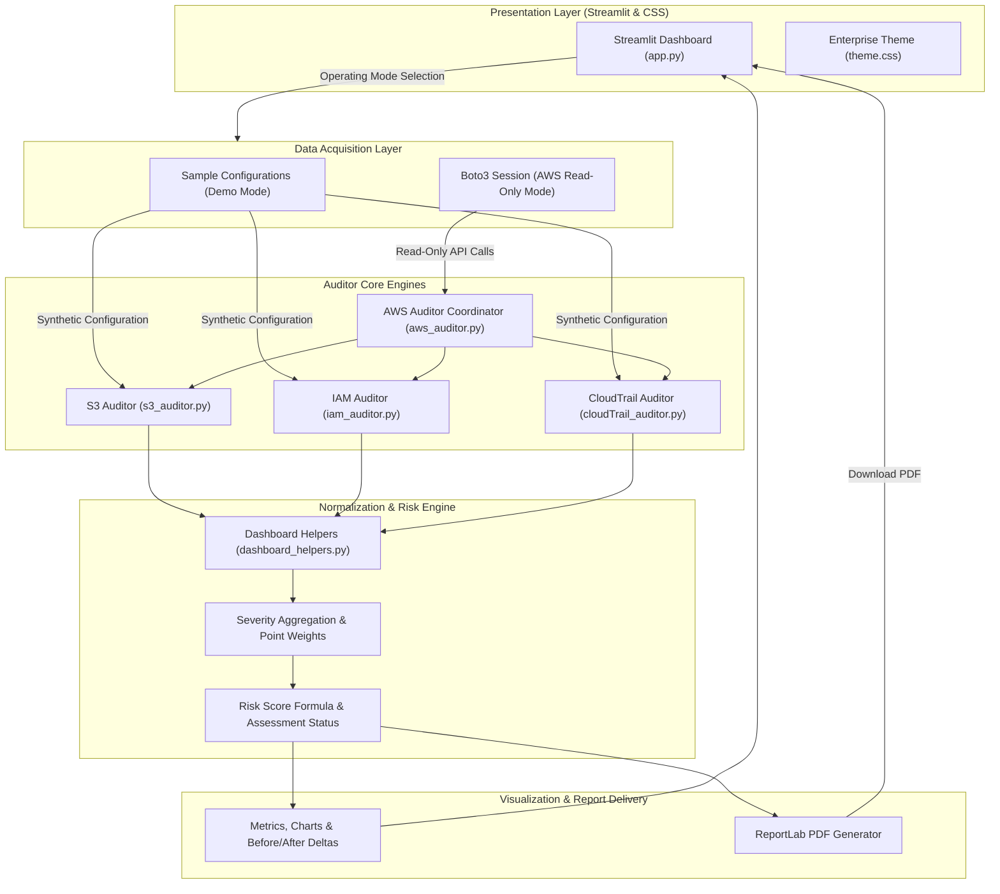

# CloudSentry — Cloud Security Misconfiguration Auditor

> An automated, read-only cloud security assessment dashboard for detecting critical misconfigurations across Amazon Web Services (AWS) storage, identity, and governance services.

[](https://aws.amazon.com/)
[](https://github.com/mishty1536/CloudSentry)
[](https://streamlit.io/)
[](https://www.python.org/)
[](LICENSE)

---

## Problem Statement

Cloud infrastructure misconfigurations represent one of the leading causes of security incidents and data leaks in modern cloud environments. Common oversights—such as accidentally disabled S3 Block Public Access settings, unencrypted storage buckets, wildcard (`*`) administrative permissions in IAM policies, unmonitored root accounts, and disabled or regionalized CloudTrail trails—expose organizations to unauthorized access, data exposure, and untracked lateral movement.

While enterprise Cloud Security Posture Management (CSPM) suites exist, they frequently require complex onboarding lifecycles, continuous high-privilege agent deployments, substantial recurring costs, and steep learning curves. Security engineers, cloud administrators, and developers need a lightweight, non-invasive assessment tool that:

1. **Operates strictly on read-only principles:** Gathers security metadata without requiring create, update, or delete privileges, eliminating any risk of service downtime or unexpected configuration changes.
2. **Surfaces clear, contextual findings:** Maps misconfigurations directly to affected resources and provides concrete remediation instructions.
3. **Provides quantitative risk assessment:** Calculates a normalized risk score, visualizes security drift across successive scans, and exports professional PDF reports for auditing and compliance records.
4. **Enables safe, offline exploration:** Includes a zero-credential Demo mode allowing users to simulate and learn about misconfiguration scenarios safely without live AWS credentials or cloud bills.

---

## Live Demo

**Application URL:** http://3.26.214.34:8501

CloudSentry is deployed on an Amazon EC2 instance running Amazon Linux 2023. The public demo deployment operates in Demo mode using sample configurations.

> **Security notice:** The demo is served over HTTP, and port 8501 is publicly accessible. Do not submit sensitive information to this deployment. AWS live scanning must remain disabled for this unauthenticated public demo.

The application is available while the EC2 instance and Streamlit process are running. Its public IP address may change if the instance is stopped and restarted.

---

## Feature List

- **S3 Storage Security Auditing:**
  - Evaluates bucket-level S3 Block Public Access configurations (`BlockPublicAcls`, `IgnorePublicAcls`, `BlockPublicPolicy`, `RestrictPublicBuckets`).
  - Verifies default server-side encryption (SSE) status for general-purpose S3 buckets.
- **IAM Identity & Privilege Auditing:**
  - Reviews account-level security hygiene, specifically checking whether Multi-Factor Authentication (MFA) is active on the root user.
  - Audits inline identity policy documents and default versions of attached managed policies to detect wildcard privileges (`Action: *`, `Resource: *`).
  - Flags heuristic risk indicators including `NotAction` and `NotResource` blocks for contextual security review.
- **CloudTrail Governance & Logging Auditing:**
  - Checks operational trail logging status (`IsLogging`) within the selected AWS region.
  - Verifies cryptographic log file integrity validation settings.
  - Evaluates multi-region trail configuration and distinguishes regional trails from account-wide coverage.
- **Risk Scoring & Posture Metrics:**
  - Aggregates findings into standard severity classifications (`High`, `Medium`, `Low`, `Unknown`, `Info`).
  - Computes a normalized 0–100 risk score based on average finding severity, paired with qualitative posture classifications (`Low Risk`, `Moderate Risk`, `High Risk`).
- **Scan Comparison (Before vs. After):**
  - Persists completed scan snapshots in a local SQLite database across sessions and application restarts.
  - Compares arbitrary compatible scans by finding identity, severity counts, and risk score; incomplete scans never turn absent findings into resolved findings.
- **Executive & Technical PDF Report Export:**
  - Generates downloadable, styled PDF reports on-demand directly from the dashboard using ReportLab.
  - Exports both full **Security Audit Reports** (detailed findings table with multi-page support) and **Security Summary Reports** (high-level executive metrics).
- **Dual Operating Modes:**
  - **Demo Mode:** Simulates AWS configurations using interactive sample toggles—completely offline, zero credentials required.
  - **AWS (Read-Only) Mode:** Connects via Boto3 credential provider chain (IAM role, AWS SSO, or local profile) to query live configuration metadata without modifying any resources.
- **Transparent Status Handling:**
  - Differentiates verified compliant/vulnerable states from **Unknown / Unverified** states when API calls are throttled, denied, or unconfigured, preventing false senses of security.

---

## Technology Stack

| Layer | Component | Technology | Description |
|---|---|---|---|
| **Frontend & UI** | Dashboard Framework | **Streamlit (v1.66+)** | Interactive single-page web dashboard with dark and light theme support |
| **Styling & Typography** | Design System | **Custom CSS (`theme.css`)** | Enterprise dark-palette design tokens with responsive Inter sans-serif typography |
| **Data Processing** | Data Manipulation | **Pandas (v3.0+)** | Findings aggregation, tabular transformation, and display formatting |
| **Cloud Integration** | AWS SDK | **Boto3 & Botocore (v1.43+)** | Read-only AWS API interactions across S3, IAM, CloudTrail, and EC2 |
| **Document Generation** | Reporting Engine | **ReportLab (v4.0+)** | In-memory PDF generation with styled tables, column wrapping, and pagination |
| **Runtime & Language** | Core Engine | **Python 3.11** | Backend execution runtime |
| **Hosting & Compute** | Cloud Infrastructure | **Amazon EC2** | Amazon Linux 2023 instance hosting the Streamlit web service |
| **Testing & Quality** | Quality Assurance | **Python `unittest` & Botocore `Stubber`** | Automated test suite with 85 unit and integration tests using mocked AWS clients |

---

## System Architecture

### Architectural Diagram



### Data Flow Overview

1. **User Interaction & Mode Selection:** The user selects either **Demo** mode or **AWS (read-only)** mode in the sidebar.
2. **Configuration Ingestion:**
   - In **Demo Mode**, sample configuration parameters (public ACL blocks, encryption settings, IAM wildcard toggles) are read directly from UI controls without network calls.
   - In **AWS Mode**, `aws_auditor.py` initializes a read-only `boto3.Session` using the ambient credential chain (EC2 IAM Role, local AWS profile, or environment variables).
3. **Auditor Execution & Heuristic Evaluation:**
   - Service responses are evaluated by specialized auditor modules (`s3_auditor.py`, `iam_auditor.py`, `cloudTrail_auditor.py`).
   - Each module tests configurations against security baseline rules, returning standardized finding dictionaries containing `service`, `severity`, `resource`, `finding`, and `recommendation`.
4. **Data Normalization & Scoring:**
   - `dashboard_helpers.py` aggregates findings across services, normalizes missing fields, and calculates a normalized 0–100 risk score based on finding severities.
   - Checks that could not be verified due to missing read permissions or throttled calls are marked `Unknown`, ensuring incomplete assessments are transparently reported as `Incomplete`.
5. **Presentation & Export:**
   - Streamlit displays metrics, interactive filters, comparative before-and-after deltas, and step-by-step remediation guides.
   - Users can trigger on-demand generation of styled PDF audit reports compiled in-memory via ReportLab.


## Project Structure

```text
CloudSentry/
├── app.py
├── aws_auditor.py
├── s3_auditor.py
├── iam_auditor.py
├── cloudTrail_auditor.py
├── dashboard_helpers.py
├── theme.css
├── requirements.txt
├── checks/
└── README.md
```

The `checks/` directory contains the automated tests. The application loads `theme.css` from the project directory, so keep it alongside `app.py`.

## Run Locally

### Prerequisites

- Python 3.11
- Git
- Internet access to install Python dependencies

### Installation

Clone the repository:

```bash
git clone https://github.com/mishty1536/CloudSentry.git
cd CloudSentry
```

Create and activate a virtual environment.

**Windows PowerShell:**

```powershell
py -3.11 -m venv .venv
.venv\Scripts\Activate.ps1
```

**Linux / macOS:**

```bash
python3.11 -m venv .venv
source .venv/bin/activate
```

Install the pinned dependencies:

```bash
python -m pip install --upgrade pip
python -m pip install -r requirements.txt
```

Run the dashboard:

```bash
python -m streamlit run app.py
```

Streamlit will display the local URL in the terminal, typically `http://localhost:8501`.

Demo mode is the default and works without AWS credentials.

## AWS EC2 Deployment

CloudSentry has been deployed to an Amazon EC2 instance using Amazon Linux 2023, Python 3.11, and Streamlit.

### Deployment Configuration

| Setting | Configuration |
|---|---|
| Cloud provider | AWS |
| Compute service | Amazon EC2 |
| Operating system | Amazon Linux 2023 |
| Python version | Python 3.11 |
| Application framework | Streamlit |
| Application port | TCP 8501 |
| Deployment mode | Public Demo mode |
| AWS scanning | Disabled for the public demo |

### Deployment Steps

Install the required system packages on the EC2 instance:

```bash
sudo dnf install git python3.11 python3.11-pip -y
```

Clone the repository:

```bash
git clone https://github.com/mishty1536/CloudSentry.git
cd CloudSentry
```

Create and activate the Python environment:

```bash
python3.11 -m venv .venv311
source .venv311/bin/activate
```

Install the dependencies:

```bash
python -m pip install --upgrade pip
pip install -r requirements.txt
```

Start Streamlit:

```bash
python -m streamlit run app.py \
  --server.address 0.0.0.0 \
  --server.port 8501
```

Configure the EC2 security group's inbound rules to allow TCP traffic on port 8501 for public demo access. SSH access on port 22 should remain restricted to trusted IP addresses.

The Streamlit process must remain running for the application to be available. Automatic restart after an EC2 reboot has not been configured.

### Public Deployment Security

- Keep `CLOUDSENTRY_ENABLE_AWS_SCAN` unset on the public demo instance.
- Do not place AWS credentials, access keys, tokens, or secrets in the source code or public repository.
- Do not enable live AWS scanning on an unauthenticated public instance.
- The current demo uses HTTP rather than HTTPS.
- Public access to port 8501 allows anyone with network access to reach the application.
- Review AWS billing and resource usage regularly. EC2 compute, storage, and public IPv4 usage may incur charges or consume account credits.
- Stop the EC2 instance when the public demo is not required.

For a production deployment, introduce appropriate authentication, HTTPS, access restrictions, logging, and operational monitoring before enabling sensitive functionality.

## Enable AWS Read-only Scanning

AWS mode is intended for a controlled, non-public environment only.

To enable AWS mode, set the environment variable:

**Linux / macOS:**

```bash
export CLOUDSENTRY_ENABLE_AWS_SCAN=true
```

**Windows PowerShell:**

```powershell
$env:CLOUDSENTRY_ENABLE_AWS_SCAN = "true"
```

Then start the application. AWS mode should only be enabled in an environment with appropriate access controls. AWS API calls begin only after the user explicitly presses **Start AWS scan**.

Unexpected Python exceptions during an AWS scan are written to the application service log with the scan phase, selected region, exception type, and traceback frames. Exception messages and local variable values are omitted to avoid logging credentials or request data. On the EC2 systemd deployment, inspect recent diagnostics with:

```bash
sudo journalctl -u cloudsentry.service -n 100 --no-pager
```

CloudSentry uses Boto3's standard credential provider chain through `boto3.Session`. Use an approved credential provider, such as IAM Identity Center/SSO or an attached IAM role.

Never paste access keys into CloudSentry, source files, Streamlit secrets, or this README. Do not commit credentials to GitHub.

The application does not print or save AWS credentials.

## Read-only IAM Permissions

Attach a least-privilege policy like the following to the identity used by Boto3. Review and tailor the permissions to your environment before use.

```json
{
  "Version": "2012-10-17",
  "Statement": [
    {
      "Sid": "ListGeneralPurposeBuckets",
      "Effect": "Allow",
      "Action": "s3:ListAllMyBuckets",
      "Resource": "*"
    },
    {
      "Sid": "ReadBucketSecurityConfiguration",
      "Effect": "Allow",
      "Action": [
        "s3:GetBucketPublicAccessBlock",
        "s3:GetEncryptionConfiguration"
      ],
      "Resource": "arn:aws:s3:::*"
    },
    {
      "Sid": "ReadIamAccountAndPolicyDetails",
      "Effect": "Allow",
      "Action": [
        "iam:GetAccountSummary",
        "iam:GetAccountAuthorizationDetails"
      ],
      "Resource": "*"
    },
    {
      "Sid": "DescribeRegionalCloudTrailTrails",
      "Effect": "Allow",
      "Action": "cloudtrail:DescribeTrails",
      "Resource": "*"
    },
    {
      "Sid": "ListAvailableRegionsForCloudTrailCoverage",
      "Effect": "Allow",
      "Action": "ec2:DescribeRegions",
      "Resource": "*"
    },
    {
      "Sid": "ReadCloudTrailStatus",
      "Effect": "Allow",
      "Action": "cloudtrail:GetTrailStatus",
      "Resource": "arn:aws:cloudtrail:*:*:trail/*"
    }
  ]
}
```

The policy grants read-only access to the listed configuration APIs. It does not grant permission to create, update, or delete AWS resources.

If a required read permission is missing, throttled, or unavailable, the affected check is reported as **Unknown / unverified**.

## AWS Check Coverage and Limitations

### S3 Auditing

- Lists general-purpose buckets with `ListBuckets`.
- Checks each returned bucket's bucket-level `GetPublicAccessBlock` configuration.
- Checks the bucket's default `GetBucketEncryption` configuration.
- Does not establish effective public access. Account-level and organization-level S3 Block Public Access controls are not queried.
- Does not inspect bucket policies, ACLs, existing objects, or KMS key policies.
- If an explicit encryption configuration is absent, the configuration is reported as unverified. The application does not claim that objects are unencrypted.
- Existing object encryption is not inspected.

### IAM Auditing

- Uses `GetAccountSummary` to check the root account MFA indicator.
- Uses paginated `GetAccountAuthorizationDetails` results to retrieve IAM users, groups, roles, inline identity policies, policy attachments, and managed policy documents.
- Audits inline identity policy documents and the default version documents for attached managed policies returned by AWS.
- Treats missing or malformed policy documents as unverified.
- Does not treat role trust policies as identity permission policies.
- Does not evaluate permissions boundaries, session policies, SCPs/RCPs, resource-based policies, service control context, policy variables, or all condition semantics.
- Does not calculate effective permissions or replace IAM Access Analyzer or AWS policy evaluation.
- Treats wildcard, `NotAction`, `NotResource`, and `Condition` findings as heuristic indicators. `NotAction`, `NotResource`, and `Condition` are surfaced for contextual review rather than automatically labeled vulnerabilities.

### CloudTrail Auditing

- Uses `DescribeTrails` in the selected region, including shadow trails.
- Uses `GetTrailStatus` to check whether each returned trail is currently logging.
- Checks trail multi-region configuration and log file validation.
- Separately enumerates AWS regions with `ec2:DescribeRegions` and checks enabled regions with `cloudtrail:DescribeTrails`, including shadow trails.
- Deduplicates trails by ARN and reports multi-region, home-region, and organization-trail metadata. Regional trails cover only their home region; a multi-region trail is treated as configured coverage for enabled regions.
- Access denied, authentication errors, unsupported regions, throttling, and malformed responses are reported as unverified. Unverified regions are never treated as confirmed gaps.
- The account-wide result assesses configured trail coverage only. `GetTrailStatus` still runs only in the selected region, so delivery/logging status is not verified account-wide.
- Regions marked `not-opted-in` are shown separately and are not scanned. If any enabled region cannot be checked, the account-wide result is partial and does not claim complete coverage or account-wide absence.
- The organization-trail flag is reported as returned metadata; the app does not independently verify organization membership or effective organization-wide coverage.
- Does not evaluate event selectors, destination bucket policies, KMS key policies, or delivery-error fields.

### Region and Risk Score

The selected AWS region is shown with AWS results. S3 bucket listing and IAM are account-level APIs. CloudTrail selected-region findings remain separate from the account-wide configured-coverage assessment. The latter requires `ec2:DescribeRegions` in addition to the CloudTrail read permissions above.

The dashboard's prototype risk score retains its existing formula. Unknown severities contribute zero points and remain in the denominator, so unverified results can lower the score. Review Unknown findings separately; a lower score does not necessarily mean that the environment is secure.

## Testing

Run the complete test suite from the project root in the Windows virtual environment:

```powershell
.venv\Scripts\python.exe -B -m unittest discover -s checks -v
```

The AWS integration tests use mocked clients, synthetic responses, and Botocore `Stubber` clients with dummy test credentials. They do not read AWS credentials or call AWS APIs.

Run tests after changing the audit logic, findings, or report-generation functionality.

## Limitations

CloudSentry is an educational prototype for selected AWS security configuration checks. It does not perform a complete cloud security assessment, penetration test, or formal compliance audit.

Findings are based on the configuration information available to the application and the implemented heuristic rules. A missing finding does not guarantee that an AWS resource is secure.

The tool should be used as an aid to security review, with results verified against AWS configuration and organizational security requirements.

## Persistent Scan History

Completed Demo and AWS scans are stored locally in SQLite. The default path is outside the repository:

- Linux: `$XDG_DATA_HOME/cloudsentry/scan_history.db` when `XDG_DATA_HOME` is set; otherwise `~/.local/share/cloudsentry/scan_history.db`
- Windows: `%LOCALAPPDATA%\CloudSentry\scan_history.db`

Set `CLOUDSENTRY_HISTORY_DB` to override the location. On the EC2 deployment, the default is under the service user's home directory (for example, `/home/ec2-user/.local/share/cloudsentry/scan_history.db`). If using `/var/lib/cloudsentry/scan_history.db`, create that directory with ownership for the service user before starting the application:

```bash
sudo install -d -o ec2-user -g ec2-user -m 700 /var/lib/cloudsentry
```

SQLite transactions and a busy timeout protect concurrent reads and writes. Findings, severity counts, risk score, scan mode, region, assessment status, and CloudTrail account-coverage metadata are stored. Incomplete scans remain marked **Incomplete**; failed scans are not saved. Comparisons require the same mode and, for AWS, the same region. Missing findings from incomplete scans are treated as unverified rather than resolved.

History survives browser sessions, Streamlit reruns, and service restarts while the database remains on persistent host storage. It is not replicated to another EC2 instance and is not protected from loss of the host's storage. The database is local to this application host. Keep the file and its directory protected: AWS findings may contain account resource identifiers. All visitors who can reach this unauthenticated app can see the shared history for the selected mode; do not expose AWS history publicly.

Back up a live database consistently with Python's SQLite backup API (replace the source path if `CLOUDSENTRY_HISTORY_DB` is set):

```bash
source_path="$HOME/.local/share/cloudsentry/scan_history.db"
backup_path="$HOME/cloudsentry-scan-history-$(date -u +%Y%m%dT%H%M%SZ).db"
python3.11 - "$source_path" "$backup_path" <<'PY'
import sqlite3
import sys

with sqlite3.connect(sys.argv[1]) as source, sqlite3.connect(sys.argv[2]) as backup:
    source.backup(backup)
PY
chmod 600 "$backup_path"
```

For the EC2 default path, restore a verified backup with:

```bash
database_path="$HOME/.local/share/cloudsentry/scan_history.db"
restore_path="$HOME/cloudsentry-scan-history-YYYYMMDDTHHMMSSZ.db"
sudo systemctl stop cloudsentry.service
cp -- "$restore_path" "$database_path"
chmod 600 "$database_path"
sudo chown ec2-user:ec2-user "$database_path"
sudo systemctl start cloudsentry.service
```

Use the configured path and service account if they differ. Keep a separate copy of the current database until the restored history has been verified.

## Future Improvements

Potential future enhancements include:

- Authentication and role-based access control.
- HTTPS and a custom domain for public deployments.
- Multi-region CloudTrail assessment.
- Broader S3 effective-public-access analysis.
- Expanded IAM policy evaluation and contextual findings.
- Improved automated deployment and monitoring.

These are possible enhancements and are not represented as completed features.

## Repository

GitHub: https://github.com/mishty1536/CloudSentry

## Author

Developed as a Cloud Computing & Security mini-project to explore AWS security misconfigurations, read-only auditing, and cloud application deployment.
